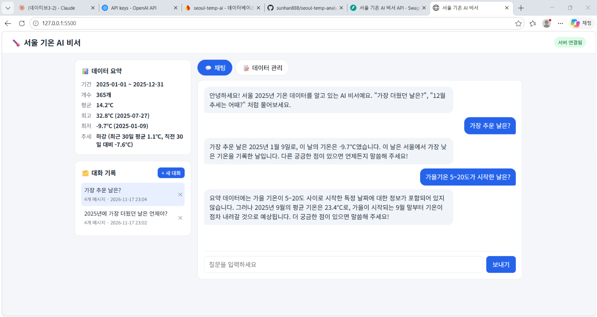
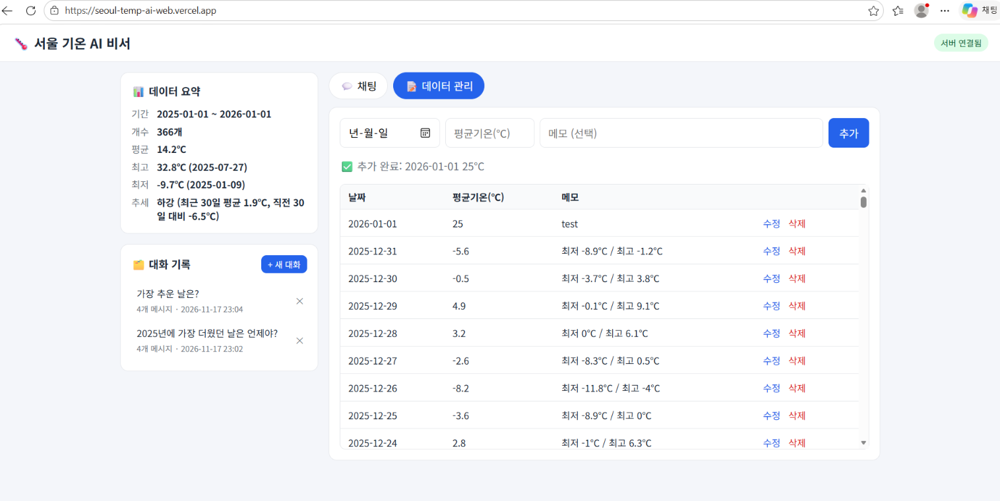
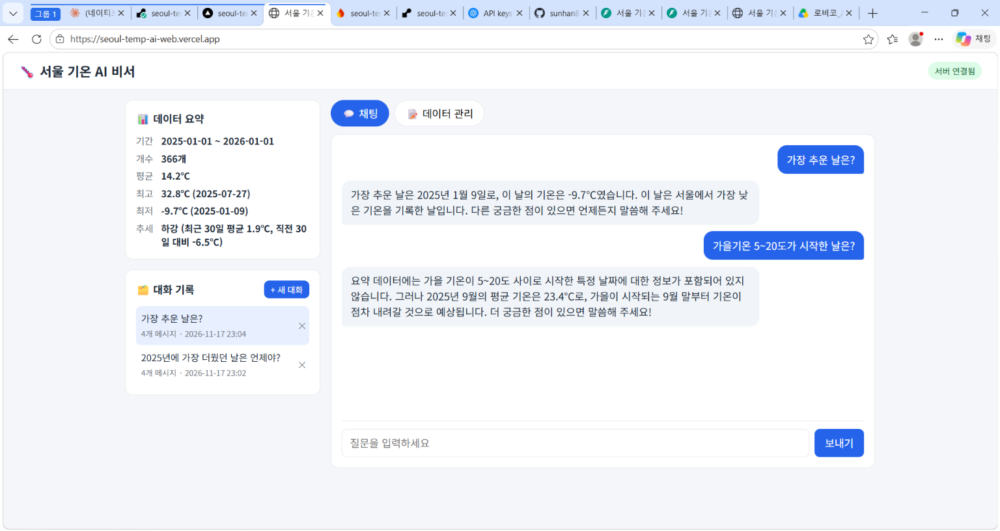

# 🌡️ 서울 기온 AI 비서

> "내 데이터를 아는 AI" — 서울 2025년 일 평균기온 365일치를 분석해 요약하고, 그 요약을 AI에게 주입해 **데이터에 근거한 맞춤형 답변**을 하는 웹 서비스입니다.

## 1. 서비스 소개 (무엇을 해결하나요?)

일반 ChatGPT에게 "작년 서울에서 가장 더웠던 날은?"이라고 물으면 일반적인 답이나 추측만 돌아옵니다.
이 서비스는 **내가 가진 실제 데이터(기상청 서울 관측값)**를 요약해 AI의 시스템 프롬프트에 넣어 주기 때문에,
"2025년 7월 27일, 32.8℃" 처럼 **내 데이터에 근거한 답**을 받을 수 있습니다.

| 기능 | 설명 |
|---|---|
| 💬 데이터 기반 AI 채팅 | 질문 → 데이터 요약을 프롬프트에 주입 → GPT 답변 (로딩 표시) |
| 📝 데이터 관리 (CRUD) | (date, value, memo) 추가 / 목록 / 수정 / 삭제, 변경 시 요약 자동 갱신 |
| 🗂️ 대화 기록 | 채팅이 자동 저장되고, 목록에서 이전 대화를 불러오기 / 삭제 |
| 📊 데이터 요약 | 기간 · 개수 · 평균/최고/최저 · 최근 추세 표시 |

### 동작 흐름 (컨텍스트 주입)

```
[브라우저]  "가장 더웠던 날은?"
    │  POST /api/chat
    ▼
[FastAPI] ① 데이터 요약 조회 (data 컬렉션 → 통계 계산, 캐시)
          ② 요약을 시스템 프롬프트에 삽입
          ③ OpenAI GPT 호출
          ④ 질문+답변을 conversations 컬렉션에 자동 저장
    │
    ▼
[브라우저]  "2025년 7월 27일, 32.8℃로 가장 더웠어요"
```

## 2. 기술 스택

| 영역 | 기술 |
|---|---|
| 백엔드 | Python 3.12+, FastAPI, Uvicorn, Pydantic |
| DB | Firebase Firestore (`firebase-admin`) |
| AI | OpenAI GPT API (`gpt-4o-mini`, `max_tokens=500`) |
| 프론트엔드 | HTML / CSS / JavaScript (바닐라, 프레임워크 없음) |
| 배포 | Render (백엔드), Vercel (프론트엔드) |
| 데이터 | 기상청 기상자료개방포털 — 서울(108) 일별 평균기온, 2025-01-01 ~ 2025-12-31, **365개** |

## 3. 배포 URL

| 구분 | URL |
|---|---|
| 프론트엔드 (Vercel) | https://YOUR-APP.vercel.app |
| 백엔드 API (Render) | https://YOUR-API.onrender.com |
| Swagger UI | https://YOUR-API.onrender.com/docs |

> ⚠️ Render 무료 서버는 15분간 요청이 없으면 잠듭니다. 첫 접속 시 깨어나는 데 최대 1분 정도 걸릴 수 있으며, 화면 상단에 안내 문구가 표시됩니다.

## 4. 프로젝트 구조

```
seoul-temp-ai-assistant/
├── backend/
│   ├── main.py                  # 앱 생성, CORS, 라우터 연결
│   ├── app/
│   │   ├── config.py            # 환경 변수
│   │   ├── firebase.py          # Firestore 연결
│   │   ├── schemas.py           # Pydantic 요청/응답 검증
│   │   ├── routers/             # URL ↔ 함수 연결 (접수 창구)
│   │   │   ├── data.py          #   /api/data, /api/data/summary
│   │   │   ├── conversations.py #   /api/conversations
│   │   │   └── chat.py          #   /api/chat
│   │   └── services/            # 실제 일 처리 (DB, 계산, GPT)
│   │       ├── data_service.py
│   │       ├── summary_service.py
│   │       ├── conversation_service.py
│   │       └── chat_service.py
│   ├── scripts/
│   │   ├── prepare_data.py      # 기상청 원본 CSV → 2025년 365개 정제
│   │   └── seed_data.py         # 정제 CSV → Firestore 업로드
│   ├── data/
│   └── requirements.txt
└── frontend/
    ├── index.html / style.css / app.js
    ├── config.js                # 로컬용 API 주소
    ├── build.js                 # Vercel 빌드 시 API_BASE_URL → config.js 생성
    └── vercel.json
```

**라우터 / 서비스 분리 기준**: 라우터는 "어떤 URL이 어떤 함수로 가는지 + HTTP 상태 코드"만, 서비스는 "Firestore 읽기/쓰기, 통계 계산, GPT 호출"만 담당합니다. 그래서 채팅 서비스는 HTTP를 거치지 않고 `summary_service.get_summary()`를 직접 재사용합니다.

## 5. API 목록

| Method | Path | 설명 |
|---|---|---|
| POST | `/api/data` | 새 데이터 추가 |
| GET | `/api/data` | 데이터 목록 (날짜순) |
| PUT | `/api/data/{id}` | 데이터 수정 (보낸 필드만) |
| DELETE | `/api/data/{id}` | 데이터 삭제 |
| GET | `/api/data/summary` | 데이터 요약 (프롬프트 주입용) |
| POST | `/api/conversations` | 대화 저장 |
| GET | `/api/conversations` | 대화 목록 — **messages 미포함** (id, title, message_count, updated_at) |
| GET | `/api/conversations/{id}` | 특정 대화 전체 messages 조회 (불러오기) |
| DELETE | `/api/conversations/{id}` | 대화 삭제 |
| POST | `/api/chat` | AI 채팅 (요약 주입 + 자동 저장) |
| GET | `/health` | 서버 상태 확인 (콜드스타트 체크) |

### Firestore 컬렉션 구조

```
data/{id}            { date: "2025-07-27", value: 32.8, memo: "최저 27.1℃ / 최고 37.0℃", created_at }
conversations/{id}   { title, messages: [{role, content, created_at}, ...], created_at, updated_at }
```

### 입력 검증 (Pydantic)
- `date`: 올바른 날짜 형식(YYYY-MM-DD)이 아니면 422
- `value`: -60 ~ 60 범위를 벗어나면 422 (기온으로 불가능한 값 차단)
- `memo`: 200자 제한 / 채팅 `message`: 1~1000자
- 수정(PUT)은 필드를 하나 이상 보내야 함
- 없는 id → 404, GPT 호출 실패 → 502

## 6. 로컬 실행 방법

```bash
# 1) 백엔드
cd backend
python -m venv venv
source venv/bin/activate          # Windows: venv\Scripts\activate
pip install -r requirements.txt
cp .env.example .env              # 값 채우기 + serviceAccountKey.json 을 backend/ 에 두기
python scripts/prepare_data.py    # (선택) 원본 CSV → 정제 CSV
python scripts/seed_data.py       # Firestore에 365개 업로드 (최초 1회)
uvicorn main:app --reload         # → http://127.0.0.1:8000/docs

# 2) 프론트엔드 (새 터미널)
cd frontend
python -m http.server 5500        # → http://127.0.0.1:5500
```

## 7. 환경 변수

| 위치 | 이름 | 설명 |
|---|---|---|
| 백엔드 | `OPENAI_API_KEY` | OpenAI API 키 |
| 백엔드 | `FIREBASE_SERVICE_ACCOUNT_JSON` | 서비스 계정 키 JSON **내용 전체** (배포용) |
| 백엔드 | `FIREBASE_SERVICE_ACCOUNT_PATH` | 서비스 계정 키 **파일 경로** (로컬용, JSON 대신 사용 가능) |
| 백엔드 | `ALLOWED_ORIGINS` | CORS 허용 도메인, 쉼표 구분 (예: `https://YOUR-APP.vercel.app,http://127.0.0.1:5500`) |
| 백엔드 | `OPENAI_MODEL` | (선택) 기본 `gpt-4o-mini` |
| 백엔드 | `OPENAI_MAX_TOKENS` | (선택) 기본 `500` — 과금 방지 |
| 프론트 | `API_BASE_URL` | 백엔드 주소 (Vercel 빌드 시 `config.js`로 주입) |

> 🔒 `.env`, `serviceAccountKey.json` 은 `.gitignore`로 GitHub에 올라가지 않습니다.

## 8. 스크린샷

### 데이터 요약이 보이는 채팅 화면


### 데이터 관리 화면 (추가/수정/삭제)


### 대화 기록 불러오기


## 9. 비용 / 보안 메모
- GPT 호출마다 `max_tokens=500`, 이전 대화는 최근 10개만 전송해 토큰 사용을 제한했습니다.
- 데이터 요약은 메모리에 캐시하고 데이터가 바뀔 때만 다시 계산해 Firestore 읽기 횟수를 줄였습니다.
- API 키와 서비스 계정 키는 코드에 없고, 모두 환경 변수로 관리합니다.
